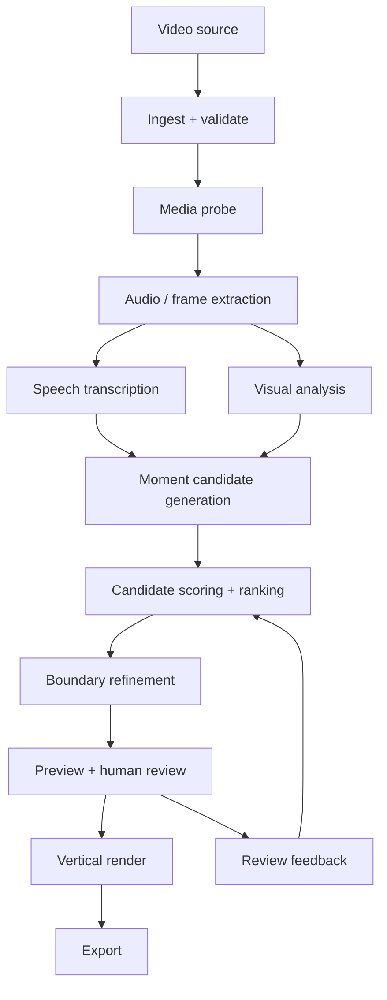

# HYDRA

> **AI-powered long-form video intelligence and short-form clipping system.**  
> Turn long videos into a ranked set of context-aware, platform-ready short clips — with human review and creator control.

**Status:** Planning / pre-MVP · **Repository:** [HYDRA-](https://github.com/shivanshchatgpt-dotcom/HYDRA-)

---

## 1. Vision

HYDRA is a focused clipping product, not a general-purpose AI assistant. Its job is to understand long-form video, discover moments worth clipping, rank those moments, and produce editable vertical videos with captions and reframing.

The product should optimize for **useful candidate clips and creator throughput**, not promise virality. No model can reliably guarantee that a clip will go viral.

### First real-world validation target

Use gaming content — including GTA 6 gameplay when legally available — as an initial test domain. This is a test case, not a dependency or a claim of affiliation with Rockstar Games. The system should also support podcasts, streams, interviews, tutorials, and commentary.

---

## 2. Product goals

1. Ingest a local video or an authorized video URL.
2. Extract audio, frames, timing, and metadata.
3. Transcribe speech with timestamps.
4. Detect meaningful moments using audio, transcript, and visual signals.
5. Generate candidate clip boundaries with enough context to make sense independently.
6. Score and rank candidates with transparent reasons.
7. Render vertical clips with captions, safe margins, and reframing.
8. Let a human review, adjust, reject, and export candidates.
9. Learn from explicit review outcomes and performance data when available.

### Non-goals for the first MVP

- Automatically publishing to social platforms.
- Guaranteeing views, revenue, or virality.
- Scraping private, paywalled, or unauthorized content.
- Replacing a creator's editorial judgment.
- Training a foundation model from scratch.

---

## 3. Core workflow



Each stage should be independently testable and restartable. Long-running work should run as jobs with explicit states, progress, logs, and retry behavior.

---

## 4. Planned architecture

The implementation should favor reliable, measurable components over forcing everything into one language or one LLM.

| Layer | Initial choice | Responsibility |
|---|---|---|
| Media engine | FFmpeg / ffprobe | Decode, probe, extract, trim, encode |
| Core orchestration | Rust | Job lifecycle, pipeline coordination, filesystem safety |
| AI workers | Python | Model integrations, speech and vision inference |
| Transcription | Whisper-family model / compatible API | Timestamped transcript |
| Moment analysis | Rules + multimodal models | Candidate generation and evidence |
| Persistence | SQLite initially | Jobs, assets, segments, scores, review decisions |
| Search / retrieval | SQLite FTS initially; optional embeddings later | Search transcripts and prior decisions |
| Interface | To be selected after a workflow prototype | Timeline, candidate review, preview, export |

These are **proposed implementation choices**, not components already implemented. Benchmark local inference against hosted APIs before locking a model or provider.

### Design principles

- **Local-first where practical:** keep raw media and intermediate assets on the user's machine by default.
- **Provider-agnostic:** model providers are adapters, not core dependencies.
- **Deterministic media operations:** FFmpeg performs exact cuts and renders; an LLM must not be the authority for frame-accurate editing.
- **Evidence-backed decisions:** every proposed clip should retain timestamps and the signals that contributed to its score.
- **Human-in-the-loop:** the creator approves final cuts and exports.
- **Resume and recover:** persist stage outputs so a failed render does not require repeating transcription.
- **Privacy and consent:** communicate clearly whenever media leaves the device for external inference.

---

## 5. Candidate discovery and ranking

HYDRA should not depend on a single "viral moment" prompt. It should combine multiple weak signals and keep the score explainable.

### Candidate signals

- **Speech / transcript:** punchlines, surprising claims, questions, strong reactions, story turns, concise explanations.
- **Audio:** energy changes, laughter, applause, emphasis, pauses, and speaker intensity.
- **Visual:** scene changes, action, facial expression where appropriate, on-screen events, and visual continuity.
- **Structure:** setup → payoff, complete thought, low dependence on unseen context, and a strong opening.
- **Editability:** clean in/out points, manageable duration, caption density, and framing feasibility.

### Illustrative scoring model

A first baseline can use a normalized weighted score:

```text
score =
    0.25 * hook_strength +
    0.20 * payoff_or_information +
    0.15 * emotional_or_energy_signal +
    0.15 * context_completeness +
    0.10 * visual_clarity +
    0.10 * editability +
    0.05 * novelty
```

Weights are **starting hypotheses**, not validated constants. Keep each feature score, evidence, model version, and weight set so rankings can be evaluated and tuned.

Do not treat loudness, profanity, facial emotion, or model confidence as a proxy for quality by itself. Penalize clips that begin mid-sentence, omit necessary setup, cut off a payoff, or rely on misleading context.

### Candidate output (conceptual)

Each candidate should contain:

- source asset and stable candidate ID
- start and end timestamps
- transcript excerpt and optional speaker labels
- hook / payoff / context notes
- per-signal scores and overall rank
- evidence references (audio interval, transcript span, frame timestamps)
- warnings (missing context, overlap, uncertain speaker, unsafe crop)
- review state and user edits

---

## 6. RAG and knowledge layer

Retrieval can improve consistency, but it should be added only when there is useful data to retrieve.

Potential knowledge sources:

- Creator-defined style and platform preferences.
- A creator's approved and rejected clip examples.
- Channel-specific terminology and recurring people / topics.
- Editing rules, caption style, and safe-zone presets.
- Prior clip performance metrics supplied by the creator.

Start with searchable transcripts and structured metadata. Add embeddings only after a measurable retrieval use case exists. Do not ingest copyrighted third-party videos as a training corpus without rights.

---

## 7. Rendering and editing

Initial output target: **9:16 vertical video**, with configurable resolution, frame rate, and duration.

Planned capabilities:

- Smart crop / subject-aware reframing with a manual override.
- Burned-in captions with editable text and timing.
- Configurable fonts, emphasis, and caption placement.
- Audio normalization and optional fades.
- Optional creator-selected intro / outro or branding.
- Preview before final encode.
- Export clean master plus optional caption file (for example SRT).

FFmpeg should own deterministic rendering. Keep an edit decision record (source range, crop path, captions, audio filters, output settings) so a render can be reproduced.

---

## 8. Suggested repository structure

The exact layout can evolve after the first vertical slice.

```text
hydra/
├── README.md
├── docs/
│   ├── architecture.md
│   ├── pipeline.md
│   ├── scoring.md
│   └── decisions/
├── apps/
│   └── desktop/              # UI, once selected
├── crates/
│   ├── hydra-core/           # Rust domain types and orchestration
│   ├── hydra-media/          # FFmpeg process integration
│   └── hydra-storage/        # SQLite and asset metadata
├── workers/
│   └── ai/                   # Python inference / provider adapters
├── tests/
│   ├── fixtures/
│   └── evaluation/
└── scripts/
```

This is a proposed structure, not a current tree.

---

## 9. MVP roadmap

### Phase 0 — Validate the pipeline

- [ ] Select 5–10 legally usable sample videos across at least two content types.
- [ ] Define a small, human-labeled set of good and bad clip moments.
- [ ] Probe files and extract audio / frames using FFmpeg.
- [ ] Produce timestamped transcripts.
- [ ] Save outputs and stage metadata locally.

**Exit condition:** the same input can be processed reproducibly and resumed after a failure.

### Phase 1 — First useful clip finder

- [ ] Candidate generation from transcript structure and audio signals.
- [ ] Candidate boundary refinement.
- [ ] Transparent scoring with evidence.
- [ ] Ranked candidate list with start/end preview.
- [ ] Human accept / reject / adjust feedback.

**Exit condition:** on a held-out sample set, HYDRA proposes useful moments that a reviewer can find and edit faster than manual scrubbing. Measure reviewer time and precision, not just model confidence.

### Phase 2 — Shorts production

- [ ] 9:16 rendering.
- [ ] Caption timing and styling.
- [ ] Reframing with manual override.
- [ ] Export presets and reproducible render settings.
- [ ] Batch processing and job recovery.

**Exit condition:** a creator can take a reviewed candidate to an export-ready short without leaving the workflow.

### Phase 3 — Personalization and evaluation

- [ ] Creator style profiles.
- [ ] Search across transcript history.
- [ ] Learn from explicit accept / reject / edit feedback.
- [ ] Optional creator-provided performance metrics.
- [ ] Offline evaluation and model / prompt regression tests.

### Phase 4 — Productization

- [ ] Desktop packaging and updates.
- [ ] Clear local / cloud processing controls.
- [ ] Usage limits, queue management, and observability.
- [ ] Licensing, onboarding, and support documentation.
- [ ] Optional integrations for authorized publishing workflows.

---

## 10. Evaluation metrics

Track measurable quality from the beginning:

| Metric | What it tells us |
|---|---|
| Candidate precision@K | How many top-ranked candidates reviewers consider usable |
| Boundary edit distance | How much users need to adjust proposed start / end |
| Reviewer time saved | Whether HYDRA is faster than manual clipping |
| Context-completeness rate | Whether clips make sense without missing setup |
| Render success rate | Reliability of the export pipeline |
| Rework rate | How often captions, crop, or timing require correction |
| Cost per processed video-hour | Economic viability across local and hosted inference |
| User acceptance rate | Whether creators actually choose suggested clips |

Views and revenue are downstream outcomes influenced by audience, channel, timing, and platform distribution. They should not be used as the only quality metric.

---

## 11. Content rights, platform rules, and safety

- Only process videos the user owns or is authorized to use.
- A public URL does not automatically grant download, editing, or redistribution rights.
- Respect platform terms, copyright, privacy, and applicable laws.
- Avoid misleading edits that materially change the meaning of a speaker's words.
- Do not automatically publish or claim ownership of generated edits.
- Keep source attribution and provenance metadata where required.
- Review the latest platform monetization and reused-content policies before building publishing or monetization features.

HYDRA is a production tool, not a guarantee of copyright clearance or platform monetization.

---

## 12. Monetization hypotheses

Potential business models to validate only after the workflow creates repeatable value:

1. Free local / limited tier for individual creators.
2. Paid creator tier with batch processing and more exports.
3. Usage-based cloud inference for users who choose hosted models.
4. Team / agency workflow with shared projects and review.
5. API or workflow integration for clipping teams.

Key cost drivers: GPU inference, transcription, storage, bandwidth, render time, and support. Measure cost per video-hour before selecting pricing. Never promise creator earnings from view counts.

---

## 13. Initial technical decisions to test

| Decision | Default hypothesis | What to benchmark |
|---|---|---|
| Media processing | FFmpeg | Throughput, codec support, reproducibility |
| Orchestration | Rust | Reliability, process control, packaging |
| AI integration | Python workers behind a stable interface | Model coverage, iteration speed |
| Transcription | Whisper-compatible backend | Word / segment timing and language quality |
| Data storage | SQLite | Query performance and migration simplicity |
| Retrieval | FTS first, embeddings later | Whether retrieval improves candidate selection |
| Inference | Local first where hardware allows; API adapter optional | Quality, latency, privacy, total cost |

Avoid premature microservices. Start as a modular application with clear internal interfaces; split processes only when isolation, throughput, or deployment requires it.

---

## 14. Working principles

- Build the smallest end-to-end slice before adding agents or complex infrastructure.
- Parallelize independent work, but keep a single source of truth for job state.
- Avoid repeated full-context model calls; cache stage outputs and use compact structured results.
- Use models for semantic judgment and deterministic code for media operations.
- Every expensive stage needs progress, cancellation, timeouts, retries, and logs.
- Keep test fixtures small and reproducible.
- Record architecture decisions when a choice becomes difficult to reverse.

---

## 15. Current status

**What exists today:** the GitHub repository and this planning document.

**What does not exist yet:** a working ingestion pipeline, transcription integration, ranking engine, UI, renderer integration, benchmarks, or release build. All architecture and milestones above are plans until implemented and tested.

### Immediate next task

Build Phase 0 as a narrow vertical slice:

1. Accept one local video.
2. Validate and probe it with ffprobe.
3. Extract audio with FFmpeg.
4. Generate a timestamped transcript.
5. Save a job record and artifacts.
6. Re-run safely without repeating completed stages.

Do not begin with multi-agent orchestration, social publishing, or a large dashboard.

---

## License

No license has been selected yet. Until a license is added, standard copyright applies; do not assume the repository is open for unrestricted reuse.
